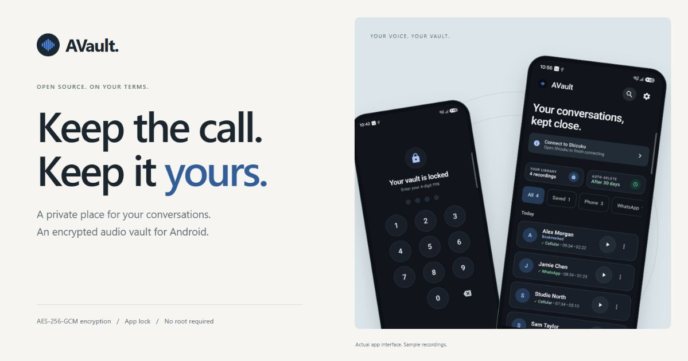
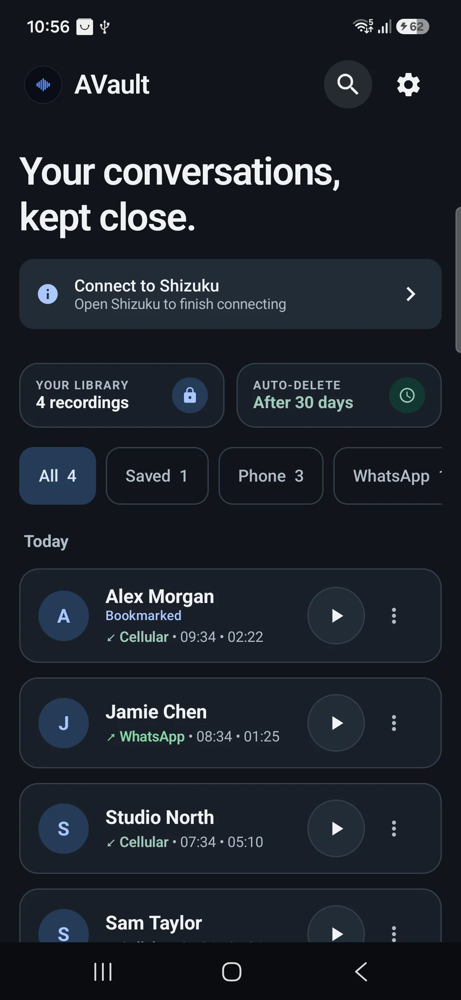
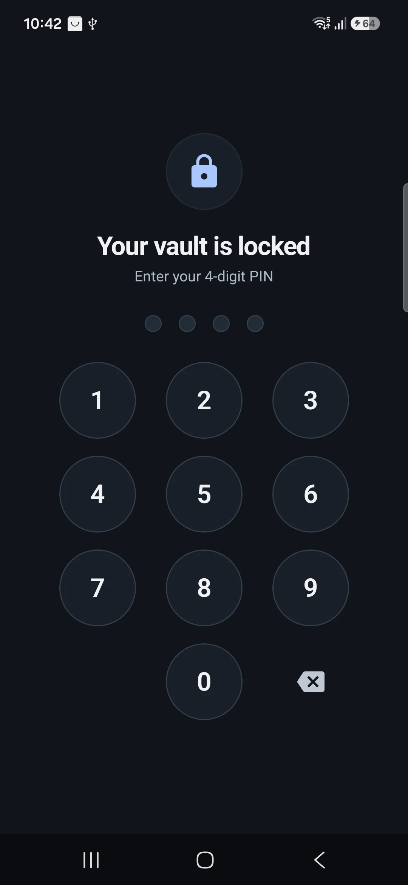
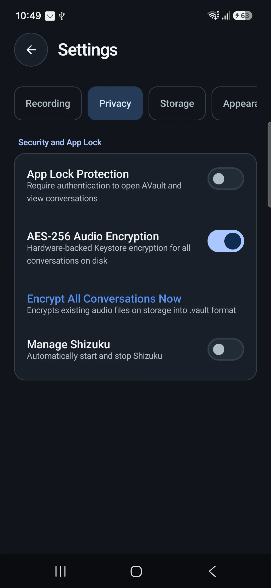

<p align="center">
  <a href="https://arpanjot-coding.github.io/AVault/">
    
  </a>
</p>

<h1 align="center">AVault</h1>
<p align="center">A private place for your conversations.</p>
<p align="center">
  <a href="https://arpanjot-coding.github.io/AVault/">Website</a> ·
  <a href="https://github.com/arpanjot-coding/AVault/releases/latest">Download</a> ·
  <a href="docs/configuration.md">Setup & configuration</a> ·
  <a href="SECURITY.md">Security</a>
</p>

AVault is a free, open-source Android call recorder and encrypted audio vault. Keep recordings organised, find a conversation quickly, and choose what stays in your library.

The app uses **Shizuku** for system access without root. It installs on **Android 11 (API 30) and later**; recording support depends on your phone, Android version, audio source and calling app. Make a test recording before relying on your setup.

## A look inside

<p align="center">
  
  &nbsp;
  
  &nbsp;
  
</p>
<p align="center"><sub>Actual Android app screens. Contacts and recordings are illustrative sample data.</sub></p>

## Features

- **An organised library.** Search by contact, phone number or app, with filters for phone calls, supported calling apps and saved recordings.
- **Encrypted audio.** AES-256-GCM encrypts recordings when enabled, with keys managed by Android Keystore. Hardware backing depends on the device.
- **App lock.** Protect access with a dedicated PIN or supported biometric/device authentication. Configure automatic locking and screen privacy.
- **Your retention rules.** Choose an auto-delete period or keep auto-delete off. Bookmarks exclude recordings from automatic cleanup.
- **Playback and sharing.** Listen inside the app or explicitly share an audio copy with another app.
- **A considered interface.** A readable library, grouped settings, and support for the existing light, dark and dynamic colour preferences.

## Get started

1. Download an APK from [GitHub Releases](https://github.com/arpanjot-coding/AVault/releases/latest) and install it on your phone.
2. Install [Shizuku](https://shizuku.rikka.app/) and follow its [setup guide](https://shizuku.rikka.app/guide/setup/) to start the service through wireless debugging or ADB.
3. Open AVault, read its first-run notice and follow the permission checklist. Authorise AVault in Shizuku.
4. Choose your recording rules, encryption, app lock and retention settings. Make a test recording and check both sides of the conversation.

Shizuku may need to be started again after the phone restarts. Third-party calling apps can restrict recording or produce one-sided/silent audio. See the [configuration guide](docs/configuration.md) and [troubleshooting guide](docs/troubleshooting.md).

## Privacy, accurately described

The vault protects stored audio; it is not a promise of protection against every threat. Playback decrypts audio into a temporary file in the app's private cache. Sharing creates a decrypted copy for the receiving app. A shared copy is outside the vault's protection.

The app lock controls access to AVault's interface. Its encryption key is managed separately through Android Keystore and is not derived from your app PIN. A compromised or unlocked device can weaken these protections. Deleting a file does not guarantee forensic erasure on flash storage.

Read [SECURITY.md](SECURITY.md) for implementation details and limitations. Record only when you have the appropriate permission and consent.

## Build from source

Use JDK 17 or later, Android SDK Platform 37, and the standard Android SDK build tools. The hidden framework stubs are included in this repository; no extra clone is required.

```sh
git clone https://github.com/arpanjot-coding/AVault.git
cd AVault
```

Set `ANDROID_HOME` to your SDK, or add its path as `sdk.dir` in an untracked `local.properties` file. The Gradle wrapper downloads the pinned Gradle version and verifies its configured SHA-256 checksum.

On macOS / Linux:

```sh
./gradlew assembleDebug
```

On Windows PowerShell:

```powershell
.\gradlew.bat assembleDebug
```

The APK is written to `app/build/outputs/apk/debug/app-debug.apk`.

```sh
adb install -r app/build/outputs/apk/debug/app-debug.apk
```

Updating an existing installation requires the same signing key. Do not uninstall an existing vault to work around a signing mismatch: that removes the app's data and its Keystore keys. Official release builds require the project's release signing credentials; a local debug build uses a development key.

## Website and product images

The product page is a static site in `docs/`, published through GitHub Pages. English, Russian, Simplified Chinese, Japanese, Vietnamese, Thai, Hindi, Arabic, French, German, Spanish and Italian each have a crawlable URL, translated metadata and reciprocal language links. Arabic uses a right-to-left layout. The public GitHub API refreshes the star count, with a dated static snapshot when unavailable. There are no testimonials or customer-count claims.

Edit `tools/site-template.html` and `docs/locales/*.json`, then regenerate the pages with `python tools/build_website.py`. It uses only the Python standard library; assets and system fonts are local.

```sh
python -m http.server 4173 --directory docs
```

Open `http://localhost:4173`. Search metadata includes a canonical URL, Open Graph / Twitter card, SoftwareApplication structured data, sitemap and robots file. Keep the canonical origin and social-image URLs aligned if the public domain changes.

For reproducible photography, `assembleScreenshots` builds an isolated sample app with the `.screenshots` application ID. It does not update the installed vault and uses generated silence and fictional contacts. Launch `com.kitsumed.shizucallrecorder.screenshots.ScreenshotActivity` with a `screen` string extra of `library`, `lock` or `settings`. The sample-only PIN is `2468`. This edition is for product images and manual UI checks, not daily recording.

## Contribute

Issues, reproducible compatibility reports and focused pull requests are welcome. Read [CONTRIBUTING.md](CONTRIBUTING.md) before contributing. For a security issue, use [private vulnerability reporting](https://github.com/arpanjot-coding/AVault/security/advisories/new) when available rather than publishing sensitive details in an issue.

## License

[GNU General Public License v3 or later](LICENSE). AVault builds on the work of this project's contributors and its upstream dependencies.
