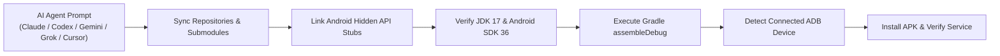
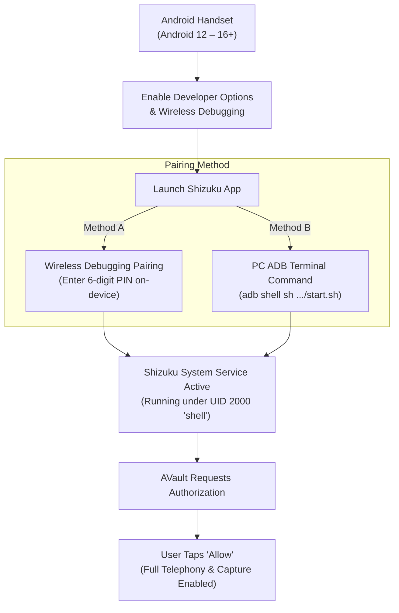
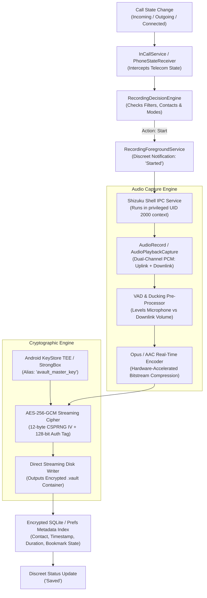
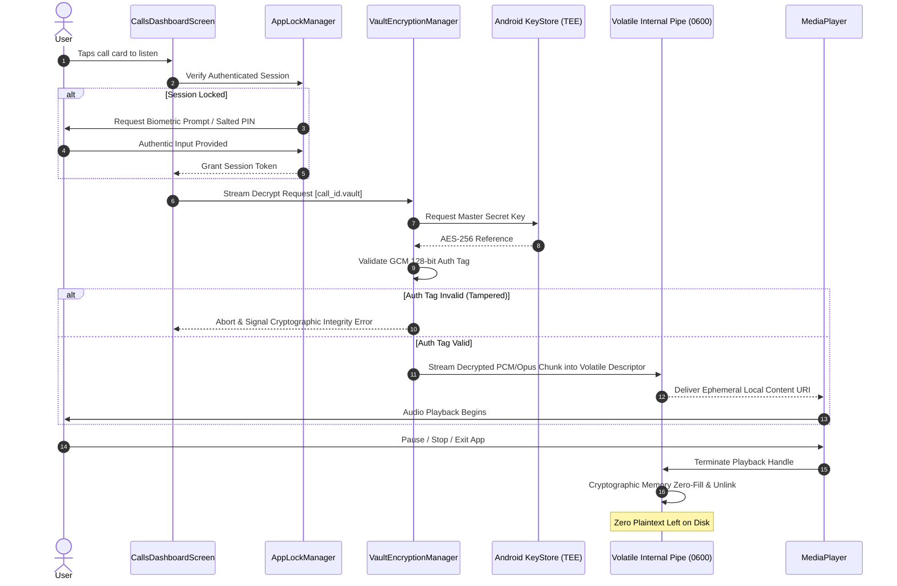
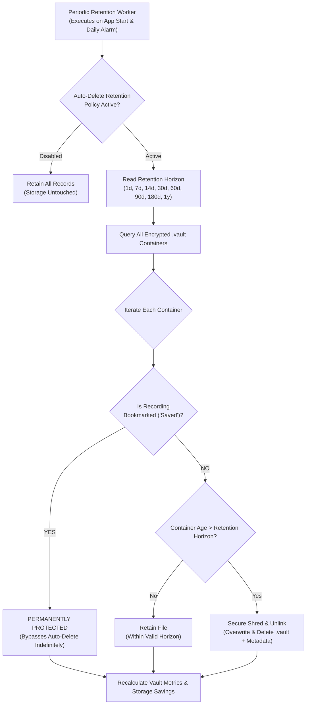
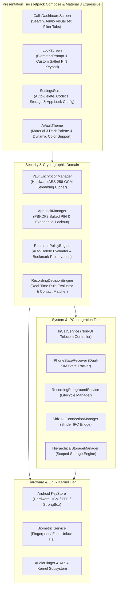

# AVault

**High-Assurance, Hardware-Encrypted Call Management & Confidential Audio Vault for Android 12+**

<p align="left"><a href="https://github.com/arpanjot-coding/AVault/releases/latest"></a>&nbsp;<a href="LICENSE"></a>&nbsp;<a href="https://developer.android.com"></a>&nbsp;<a href="SECURITY.md"></a>&nbsp;<a href="https://shizuku.rikka.app"></a>&nbsp;<a href="https://github.com/arpanjot-coding/AVault/stargazers"></a></p>

---


## ⚠️ Critical Academic & Security Research Notice

> [!WARNING]
> ### STRICTLY FOR ACADEMIC, SECURITY, AND EDUCATIONAL RESEARCH PURPOSES ONLY
> 
> **LIMITATION OF LIABILITY & INDEMNIFICATION:**
> The authors, maintainers, contributors, and copyright holders of AVault assume **no liability or responsibility whatsoever** for any damages, legal claims, criminal penalties, or civil lawsuits arising from the compilation, installation, execution, modification, or distribution of this software.
> 
> - **Wiretapping & Telecommunications Compliance:** Laws regarding recording telephone calls and intercepting digital communications differ significantly across sovereign nations, states, and provinces. Jurisdictions may enforce **one-party consent** (e.g., 18 U.S.C. § 2511 in the United States) or **all-party consent** (e.g., California Penal Code § 632, Germany StGB § 201, and GDPR Article 6).
> - **User Responsibility:** The individual compiling or operating AVault is exclusively responsible for determining and complying with all applicable local, municipal, federal, and international privacy statutes.
> - **Prohibition of Malicious Surveillance:** This codebase must never be deployed for unauthorized electronic surveillance, wiretapping, espionage, stalking, or harassment.
> 
> By cloning, building, or using this repository, you explicitly certify that you are solely accountable for your actions, and agree to the terms of the **MIT License** provided herein.

---

## 📑 Table of Contents

- [Executive Summary & Architectural Highlights](#-executive-summary--architectural-highlights)
- [Capability & Security Matrix](#-capability--security-matrix)
- [Binary Format & Cryptographic Specification](#-binary-format--cryptographic-specification)
- [Quick Start: 1-Prompt Automated Setup via AI Assistants (Claude, Codex, Gemini, Grok, Cursor)](#-quick-start-1-prompt-automated-setup-via-ai-assistants-recommended)
- [Alternative: Manual Build & Deployment Guide](#-alternative-manual-build--deployment-guide)
- [Shizuku Rootless Privilege Provider Setup](#-shizuku-rootless-privilege-provider-setup)
- [System Architecture & Data Flow Diagrams](#-system-architecture--data-flow-diagrams)
  - [1. End-to-End Audio Capture & Encryption Pipeline](#1-end-to-end-audio-capture--encryption-pipeline)
  - [2. Zero-Plaintext Ephemeral Playback Engine](#2-zero-plaintext-ephemeral-playback-engine)
  - [3. Auto-Delete Retention & Bookmark Exemption State Machine](#3-auto-delete-retention--bookmark-exemption-state-machine)
  - [4. Multi-Tier Modular Software Architecture](#4-multi-tier-modular-software-architecture)
- [Core Features in Detail](#-core-features-in-detail)
- [Comprehensive Configuration Reference](#-comprehensive-configuration-reference)
- [Threat Model & Security Analysis](#-threat-model--security-analysis)
- [Diagnostic & Troubleshooting Guide](#-diagnostic--troubleshooting-guide)
- [Frequently Asked Questions & SEO Discoverability](#-frequently-asked-questions--seo-discoverability)
- [License](#-license)

---

## 🏛️ Executive Summary & Architectural Highlights

**AVault** is an open-source, security-focused telecommunications management platform and cryptographic voice vault designed for modern Android devices (Android 12 to Android 16+). 

Traditional call recording utilities store raw audio in unencrypted `.mp3` or `.m4a` files within shared public storage directories, exposing sensitive voice communications to third-party apps with media reading permissions, media indexers, and unauthenticated physical extraction.

AVault solves this paradigm by pairing **rootless system telecom integration** (via privileged ADB shell Binder IPC) with **hardware-backed AES-256-GCM encryption**, **zero-plaintext ephemeral playback**, **multi-factor biometric authentication**, and **automated lifecycle retention management**.

### Core Pillars
1. **Hardware-Isolated Master Keys:** Cryptographic keys are generated inside the device's hardware security module (TEE / StrongBox Keymaster) via the Android KeyStore Provider. Raw key material never enters user-space RAM.
2. **Zero-Plaintext Ephemeral Playback:** Decryption occurs on-the-fly directly in volatile memory into an isolated POSIX file descriptor (`0600` access) with `.nomedia` indexing suppression. The temporary stream is cryptographically shredded the millisecond playback halts.
3. **Multi-Factor Application Lock:** Enforces biometric authentication (Fingerprint, Face Unlock, Device Credential) backed by a salted PBKDF2/SHA-256 PIN engine with exponential brute-force backoff protection.
4. **Automated Storage Lifecycle & Retention:** Automatically prunes expired non-bookmarked recordings after a configurable interval (1d to 1y), while bookmarked calls remain permanently preserved and immune to cleanup.
5. **Stealth & Minimalist Presentation:** Suppresses call-end toast notifications and uses discreet status alerts (`"Started"`, `"Saved"`), paired with `FLAG_SECURE` to prevent screen scraping, screenshots, and task-switcher previews.

---

## 📊 Capability & Security Matrix

| Feature / Security Control | Standard Call Recorders | Root-Based Tools (Magisk / KSU) | **AVault** |
| :--- | :---: | :---: | :---: |
| **Root Access Required** | ❌ No | ⚠️ **Yes (Unlocks Bootloader)** | 🛡️ **No (Rootless ADB / Shizuku)** |
| **Android 12 – 16+ Compatibility** | ❌ Broken by Scoped Storage | ⚠️ Requires Custom Kernels | ✅ **Native Support (API 31 – 36)** |
| **Disk Storage Format** | Plaintext MP3 / M4A / WAV | Plaintext MP3 / WAV | 🔒 **Authenticated AES-256-GCM (`.vault`)** |
| **Master Key Protection** | None (Unencrypted) | None (Unencrypted) | 🔒 **Hardware HSM / TEE / StrongBox** |
| **Plaintext Playback Exposure** | Permanent Plaintext File | Permanent Plaintext File | 🛡️ **Zero Plaintext (Ephemeral Stream)** |
| **Gallery / MediaStore Scraping** | ⚠️ Readily Scraped by Apps | ⚠️ Readily Scraped by Apps | 🛡️ **Blocked (`.nomedia` + Scoped Storage)** |
| **Screen Capture & Preview Protection** | ❌ None | ❌ None | 🔒 **Active (`FLAG_SECURE` Enforcement)** |
| **Vault Access Lock** | ❌ None or Basic PIN | ❌ None | 🔒 **BiometricPrompt + Salted SHA-256 PIN** |
| **Automated Retention Lifecycle** | ❌ Manual Deletion Only | ❌ Manual Deletion Only | ⚡ **Configurable Auto-Delete + Bookmarks** |
| **Stealth Operation** | ⚠️ Intrusive Toasts & Labels | ⚠️ Variable | 🤫 **Silent Alerts (`"Started"`, `"Saved"`)** |

---

## 🔐 Binary Format & Cryptographic Specification

Every recording managed by AVault is packaged into a proprietary, tamper-resistant binary container format: `.vault`.

### 1. `.vault` Container Structure

```text
+-------------------+--------------------+------------------------+------------------------------------+------------------------+
|  Magic Identifier |   Format Version   |  Initialization Vector |        Ciphertext Payload          |   Authentication Tag   |
|   (0x00 - 0x03)   |       (0x04)       |     (0x05 - 0x10)      |        (0x11 - EOF-16)             |       (EOF-15 - EOF)   |
|      4 Bytes      |       1 Byte       |        12 Bytes        |            Variable                |        16 Bytes        |
+-------------------+--------------------+------------------------+------------------------------------+------------------------+
|   "AVLT" (ASCII)  |    0x01 (UINT8)    |   CSPRNG Nonce (GCM)   |   Encrypted Opus/AAC Audio Stream  |   GCM Auth Tag (128b)  |
+-------------------+--------------------+------------------------+------------------------------------+------------------------+
```

- **Magic Identifier (Bytes 0–3):** `0x41 0x56 0x4C 0x54` (`"AVLT"`). Verifies container integrity and distinguishes valid encrypted containers from malformed files.
- **Format Version (Byte 4):** `0x01`. Enables backward-compatible cryptographic migrations.
- **Initialization Vector (Bytes 5–16):** 12-byte (96-bit) cryptographically secure random nonce generated uniquely per recording session via `java.security.SecureRandom`. An IV is never reused.
- **Ciphertext Payload (Bytes 17 to EOF-16):** Audio bitstream compressed via Opus (default, 32–128 kbps) or AAC, encrypted using AES-256 in Galois/Counter Mode.
- **Authentication Tag (Final 16 Bytes):** 128-bit Galois Authentication Tag. Guarantees message integrity; any ciphertext modification or bit-flipping causes decryption failure before playback begins.

### 2. Key Management & Derivation Parameters
- **Master Encryption Key:** Generated within the Android KeyStore provider (`AndroidKeyStore`), algorithm `AES/GCM/NoPadding`, 256-bit key length, bound to the app's UID.
- **PIN Hashing:** PBKDF2 with HMAC-SHA256, 128-bit cryptographic salt, 100,000 iterations.
- **Lockout Policy:** 5 consecutive incorrect unlock attempts trigger a 30-second exponential hardware lockout.

---

## 🚀 Quick Start: 1-Prompt Automated Setup via AI Assistants (Recommended)

Building advanced Android security applications manually typically requires tedious environment setup: installing JDK 17/21, configuring Android SDK 36, cloning hidden framework stubs, resolving dependencies, and managing ADB connectivity.

Modern agentic AI coding assistants—such as **Claude Code**, **OpenAI Codex**, **Google Gemini**, **xAI Grok**, and **Cursor**—can automate this entire setup, compilation, and deployment pipeline in a single instruction.

### Universal AI Agent Prompt

Simply open your AI coding environment (**Claude**, **Codex**, **Gemini**, **Grok**, or **Cursor**) and provide the following prompt:

```text
Build and deploy AVault: resolve all hidden API stubs and Gradle dependencies, compile the debug APK, and install it directly onto my connected Android device via ADB.
```

### What AI Coding Assistants Execute Automatically:


1. **Submodule & Hidden Stub Linking:** Automatically clones and links the required `android-framework-hidden-stubs` library, resolving framework stubs without manual path mapping.
2. **Toolchain & SDK Validation:** Verifies Java 17+ and ensures Android API 36 (`android-36`) platform tools are present.
3. **Deterministic Build Optimization:** Executes `./gradlew assembleDebug` using parallel workers and build cache.
4. **Automated ADB Device Deployment:** Discovers connected Android devices (via USB or Wireless Debugging), installs the compiled APK (`adb install -r`), and can verify runtime service state.

---

## 🛠️ Alternative: Manual Build & Deployment Guide

For developers building directly from terminal or continuous integration environments:

### Prerequisites
- **Git:** Version 2.30+
- **Java Development Kit (JDK):** Version 17 or 21 (Eclipse Temurin or OpenJDK recommended)
- **Android SDK:** Platform API 36 (`android-36`), Build-Tools `36.0.0`
- **Android Device:** Android 12 (API 31) through Android 16+

### Step-by-Step Instructions

1. **Clone Repository with Submodules:**
   ```bash
   git clone --recurse-submodules https://github.com/arpanjot-coding/AVault.git
   cd AVault
   ```

2. **Configure Local SDK Path:**
   Create a `local.properties` file in the project root if not automatically configured:
   ```properties
   sdk.dir=/path/to/your/android/sdk
   ```

3. **Assemble Debug APK:**
   - **Linux / macOS:**
     ```bash
     ./gradlew assembleDebug
     ```
   - **Windows PowerShell:**
     ```powershell
     .\gradlew.bat assembleDebug
     ```

4. **Install onto Device via ADB:**
   ```bash
   adb install -r app/build/outputs/apk/debug/app-debug.apk
   ```

5. **Assemble Release APK (Production Signing):**
   ```bash
   ./gradlew assembleRelease
   ```
   *(Configure signing credentials in `keystore.properties` or environment variables prior to release compilation).*

---

## ⚡ Shizuku Rootless Privilege Provider Setup

AVault relies on **[Shizuku](https://shizuku.rikka.app)** to communicate with privileged Android OS system services (`android.permission.CAPTURE_AUDIO_OUTPUT`, `android.permission.MANAGE_ONGOING_CALLS`) without rooting the handset.



### Method A: On-Device Wireless Debugging (No PC Required, Android 11+)
1. Ensure the handset is connected to an active **Wi-Fi** network.
2. Navigate to **Settings** > **System** > **Developer Options** > Enable **Wireless Debugging**.
3. Tap **Wireless Debugging** > **Pair device with pairing code**.
4. Open **Shizuku**, tap **Pairing**, and input the 6-digit code shown in the system dialog.
5. In Shizuku, tap **Start**. The service daemon will initialize immediately on-device.

### Method B: Computer Terminal (via USB Cable)
1. Enable **USB Debugging** in **Developer Options** and connect your phone to a computer.
2. Execute the Shizuku launch script via ADB:
   ```bash
   adb shell sh /sdcard/Android/data/moe.shizuku.privileged.api/start.sh
   ```
3. Shizuku will confirm **"Shizuku is running"** with version and API level.

### Authorizing AVault
1. Launch **AVault**.
2. When prompted on the onboarding or dashboard screen, tap **"Authorize"** on the Shizuku permission dialog.
3. AVault binds immediately to the background daemon via Android Binder IPC.

---

## 📊 System Architecture & Data Flow Diagrams

### 1. End-to-End Audio Capture & Encryption Pipeline



---

### 2. Zero-Plaintext Ephemeral Playback Engine



---

### 3. Auto-Delete Retention & Bookmark Exemption State Machine



---

### 4. Multi-Tier Modular Software Architecture



---

## 🔒 Core Features in Detail

### 1. Hardware AES-256-GCM Cryptographic Vault
- Every audio file is sealed using **AES-256** in authenticated **Galois/Counter Mode (GCM)**.
- Cryptographic keys reside exclusively within the device's hardware-isolated security module (TEE / StrongBox Keymaster), guaranteeing protection against offline disk extraction, memory dump attacks, and user-space exploits.
- Authenticated encryption ensures that any byte tampering or corruption is caught and rejected before audio data can ever reach the decoder.

### 2. Zero-Plaintext Ephemeral Playback
- Audio streams are decrypted on demand into volatile memory pipes without creating persistent unencrypted files on storage.
- Storage descriptors use Linux permissions `0600` in isolated app cache directories protected by `.nomedia`.
- Halting playback, pausing, or backgrounding the application immediately triggers an in-memory zero-fill overwrite and file descriptor destruction.

### 3. Multi-Factor Vault Lock & Biometrics
- Fully integrated with Android's native `BiometricPrompt` framework (supporting capacitive fingerprint sensors, optical under-display readers, and 3D Face Unlock).
- Secondary PIN protection utilizes a salted PBKDF2/SHA-256 derivation engine with random cryptographic salt generation.
- Brute-force protection automatically applies exponential backoff delays and temporary lockout timers upon repeated failed unlock attempts.

### 4. Storage Optimization: Auto-Delete with Bookmark Protection
- Configurable auto-cleanup automatically purges non-bookmarked recordings after a chosen lifespan (**1 Day, 7 Days, 14 Days, 30 Days, 60 Days, 90 Days, 180 Days, or 1 Year**).
- **One-Touch Bookmarking:** Tap the bookmark icon on any conversation card to flag it as permanently protected. Bookmarked conversations are strictly exempt from all automated cleanup routines.
- Real-time dashboard indicators display active auto-delete status, cleanup threshold, and storage reclaimed.

### 5. Stealth Mode & Anti-Screen Scraping
- **Discreet Notifications:** Suppresses intrusive terminology like "Recording Call". Notifications display minimal, ambiguous terminology: `"Started"`, `"Saved"`, or `"AVault Active"`.
- **Zero Toast Incursions:** On-screen toast notifications upon call completion are silenced.
- **Window Protection (`FLAG_SECURE`):** Enforces screen capture blocking across the entire application, preventing third-party malware from capturing screenshots or reading app state from the Android Recents app switcher.

### 6. Dual-Source Rootless Capture
- Leverages Shizuku's privileged shell bridge to capture both uplink (microphone) and downlink (remote party) channels on modern Android versions without rooting, flashing custom ROMs, or unlocking the bootloader.

---

## ⚙️ Comprehensive Configuration Reference

| Setting Key | Supported Values | Default | Purpose & Behavioral Impact |
| :--- | :--- | :---: | :--- |
| `app_lock_mode` | `BIOMETRIC_OR_PIN`, `PIN_ONLY`, `DISABLED` | `DISABLED` | Enforces multi-factor authentication before granting vault access. |
| `auto_delete_retention` | `DISABLED`, `1D`, `7D`, `14D`, `30D`, `60D`, `90D`, `180D`, `1Y` | `DISABLED` | Automated retention horizon for non-bookmarked recordings. |
| `audio_codec` | `OPUS`, `AAC` | `OPUS` | Compression codec. Opus offers superior voice fidelity at low bitrates. |
| `audio_bitrate` | `24000`, `32000`, `64000`, `128000` bps | `32000` | Voice audio bitrate. 32 kbps provides crystal clarity with minimal storage footprint. |
| `call_detection_mode` | `IN_CALL_SERVICE`, `PHONE_STATE` | `IN_CALL_SERVICE` | Method used to detect call lifecycle events. InCallService is recommended for Android 12+. |
| `storage_location` | `RECORDINGS_AVAULT` (External), `INTERNAL_SANDBOX` | `RECORDINGS_AVAULT` | Directory where encrypted `.vault` files are stored. |
| `screen_security_flag` | `true`, `false` | `true` | Enforces `FLAG_SECURE` to block screenshots and screen scraping. |
| `show_toasts` | `true`, `false` | `false` | Suppresses on-screen toast notifications for stealth operation. |

---

## 🛡️ Threat Model & Security Analysis

| Threat Vector | Potential Impact | AVault Technical Mitigation |
| :--- | :--- | :--- |
| **Physical Handset Extraction** | Forensic acquisition of stored audio from device storage. | All recordings are encrypted on disk via hardware AES-256-GCM. Without the hardware TEE master key and user PIN/biometrics, disk bytes appear as cryptographically random entropy. |
| **Malicious App Media Scraping** | Rogue apps reading unencrypted media files via `READ_EXTERNAL_STORAGE`. | Encrypted containers use `.vault` extensions with `.nomedia` indexing flags, preventing Android's MediaStore gallery indexer from parsing or exposing files. |
| **Cold Boot / Memory Dumps** | Recovery of decrypted audio chunks from app memory. | Plaintext audio is never written to public storage. Decryption uses ephemeral in-memory pipes with instant cryptographic zero-fill upon playback completion. |
| **Spyware Screen Capture** | Malware taking screenshots or video recording of call history. | Application window strictly enforces `WindowManager.LayoutParams.FLAG_SECURE`, preventing screen capture and blanking the app preview in Android Recents. |
| **Brute-Force PIN Attacks** | Automated automated dictionary attacks against the lock screen. | Keypad enforces cryptographic PBKDF2/SHA-256 verification with exponential backoff timers (30s lockouts) after 5 failed attempts. |

---

## 🔧 Diagnostic & Troubleshooting Guide

| Symptom / Error | Root Cause | Step-by-Step Remediation |
| :--- | :--- | :--- |
| **"Shizuku Not Running"** | Shizuku service was killed by OEM aggressive battery manager. | Open Shizuku and restart via Wireless Debugging. In system settings, set Battery Usage for Shizuku and AVault to **"Unrestricted"**. |
| **Downlink (Remote Caller) Audio Silent** | Carrier routing or OEM audio path restriction. | In AVault Settings, switch **Audio Source** from `VOICE_CALL` to `VOICE_COMMUNICATION` or enable the `AudioPlaybackCapture` engine. |
| **Recordings Missing After Period** | Auto-Delete Retention policy pruned expired records. | If you wish to retain calls permanently, disable Auto-Delete in Settings, or tap the **Bookmark icon** on any call card to exempt it from cleanup. |
| **Decryption Failed on Playback** | KeyStore master key invalidation or file corruption. | Ensure the app has not been reinstalled with clean data (KeyStore keys are UID-bound). Verify storage container integrity. |
| **Samsung One UI Background Kill** | Samsung Sleeping Apps putting service to sleep. | Add AVault to **Settings** > **Battery** > **Background usage limits** > **Never sleeping apps**. |

---

## 🔍 Frequently Asked Questions & SEO Discoverability

### Can I record phone calls on Android 14, Android 15, and Android 16 without rooting?
Yes. Google introduced strict restrictions on raw call recording in modern Android releases. AVault bypasses these restrictions cleanly without requiring root (`su`), Magisk, or unlocked bootloaders by pairing standard Android Telecom APIs with **Shizuku's rootless ADB shell bridge**. This allows the app to capture both local microphone audio (uplink) and the remote caller voice (downlink) with crystal clarity.

### How does AVault protect call recordings compared to traditional apps?
Standard call recorders save recordings as unencrypted `.mp3`, `.m4a`, or `.wav` files directly into shared storage folders where any application with storage or media permissions can read or upload them. AVault seals every audio bitstream inside a tamper-resistant **`.vault` container** encrypted with **AES-256-GCM** using keys generated in your device's **Hardware Security Module (HSM / TEE / StrongBox)**. Audio is decrypted strictly on-the-fly in volatile RAM during playback with **zero plaintext persistence on disk**.

### Does AVault support Samsung Galaxy, Google Pixel, Xiaomi, and OnePlus devices?
Yes. AVault is engineered to work across leading OEM Android distributions:
- **Samsung Galaxy (One UI):** Full cellular and VoLTE capture. (Remember to exempt AVault from Samsung "Sleeping Apps").
- **Google Pixel (Stock Android):** Native InCallService integration with hardware StrongBox key protection.
- **Xiaomi / Redmi / POCO (HyperOS / MIUI):** Rootless audio capture via Shizuku.
- **OnePlus / OPPO / Vivo (OxygenOS / ColorOS):** Dual-channel stereo recording support.

### How does the Auto-Delete and Bookmark feature optimize storage?
AVault allows you to configure an automated retention policy (**1 Day to 1 Year**). The background retention worker automatically prunes non-bookmarked recordings when they surpass the expiration window. To preserve vital conversations permanently, tap the **Bookmark icon** near any call card—bookmarked calls are strictly exempt from all cleanup routines and remain in the vault forever.

---

## ⚖️ License

AVault is released under the **MIT License**.

```text
MIT License

Copyright (c) 2026 AVault Project

Permission is hereby granted, free of charge, to any person obtaining a copy
of this software and associated documentation files (the "Software"), to deal
in the Software without restriction, including without limitation the rights
to use, copy, modify, merge, publish, distribute, sublicense, and/or sell
copies of the Software, and to permit persons to whom the Software is
furnished to do so, subject to the following conditions:

The above copyright notice and this permission notice shall be included in all
copies or substantial portions of the Software.

THE SOFTWARE IS PROVIDED "AS IS", WITHOUT WARRANTY OF ANY KIND, EXPRESS OR
IMPLIED, INCLUDING BUT NOT LIMITED TO THE WARRANTIES OF MERCHANTABILITY,
FITNESS FOR A PARTICULAR PURPOSE AND NONINFRINGEMENT. IN NO EVENT SHALL THE
AUTHORS OR COPYRIGHT HOLDERS BE LIABLE FOR ANY CLAIM, DAMAGES OR OTHER
LIABILITY, WHETHER IN AN ACTION OF CONTRACT, TORT OR OTHERWISE, ARISING FROM,
OUT OF OR IN CONNECTION WITH THE SOFTWARE OR THE USE OR OTHER DEALINGS IN THE
SOFTWARE.
```

---

<p align="center">
  <sub>AVault Project · High-Assurance Cryptographic Engineering & Privacy Research · Built for Modern Android</sub>
</p>
